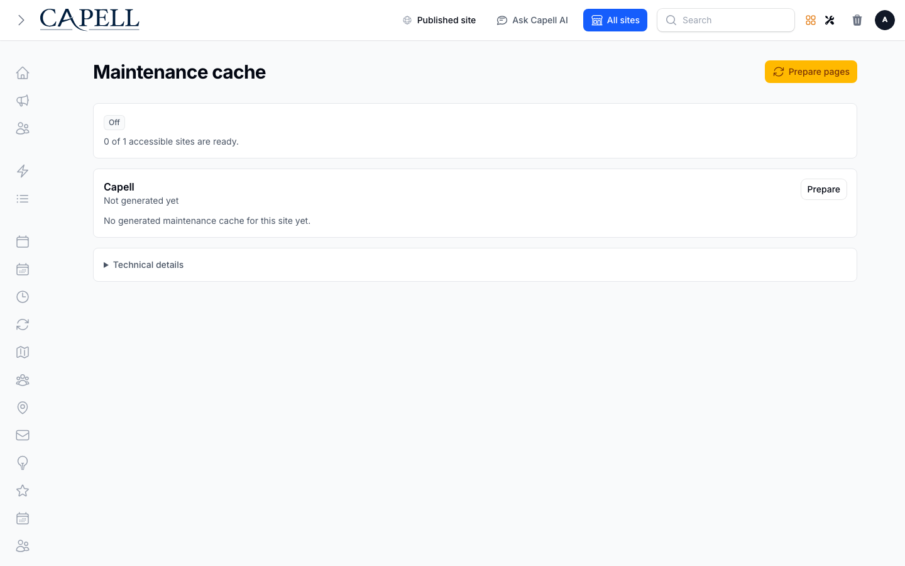
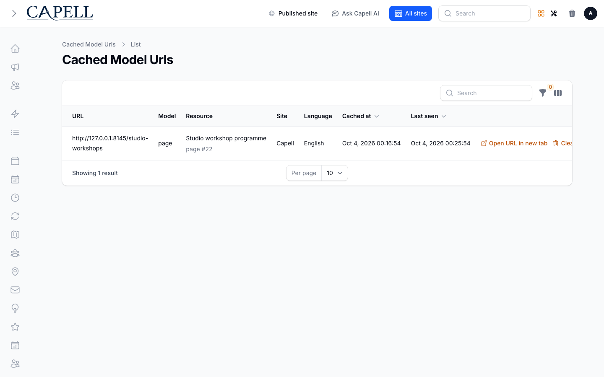

# HTML Cache

<!-- prettier-ignore-start -->

Visitors who are not signed in get a finished copy of each public page, kept on your server. A crowd arriving at once then does not make your site rebuild the same page again and again. It needs the site's scheduled tasks and background jobs running, which your developer or host sets up.

Signed-in people always see the live page, so editors previewing a change never get a stale copy. Change the opening hours and only the pages that display hours are refreshed. Refreshing happens at once or in batches every five minutes. Switching a site off, publishing a page that was hidden or changing who can see a protected area clears every stored page. Creating or restoring a page, or changing a site's domain, does the same.

Super Admins, and anyone you give the cache permissions to, get a Cached pages list. It shows each address, its language and when it was stored, with a clear button for each. A maintenance screen prepares holding pages for each site, ready to switch on while you work. Switch on the optional column in the pages list and it puts a tick beside each page that visitors get from a stored copy. Clicking the tick clears that page.

- **Price and availability:** Check current availability and price on the [Capell Marketplace listing](https://capell.app/marketplace/extensions/html-cache).
- **Licence:** Check the licence terms on the [Capell Marketplace listing](https://capell.app/marketplace/extensions/html-cache).
- **Requires:** `PHP ^8.4`, `capell-app/admin ^1.0.78`, `capell-app/core ^1.0.79`, `capell-app/discovery-foundation ^1.0`, `capell-app/frontend ^1.0.79`, `laravel/framework ^12.41.1|^13.0`, `lorisleiva/laravel-actions ^2.8`, `spatie/laravel-data ^4.5`, `spatie/laravel-package-tools ^1.14`.
- **Install:** `composer require capell-app/html-cache`.

## Quick Start

1. Install the package: `composer require capell-app/html-cache`.
2. Open the package admin surface at `/admin/html-cache/maintenance-cache` and confirm HTML Cache is available.

## For Developers

Middleware eligibility rules and dependency-indexed Actions keep cache writes, invalidation, stale claims, and atomic refresh behaviour explicit and testable. Private SiteSpec repair synchronously withdraws the entire HTML cache under its publication guard and awaits the configured edge purge; failures propagate so Core can retry before recording completion.

## Configure

- **Configuration files:** `config/capell-html-cache.php`.
- **Commands:** `php artisan capell:html-cache:clear`, `php artisan capell:html-cache:diagnose`, `php artisan capell:html-cache:edge-purge:verify`, `php artisan capell:html-cache:process-stale`, `php artisan capell:static-site`.

## Limits And Pitfalls

- Install the required Capell packages at the versions in `composer.json`: `capell-app/admin ^1.0.78`, `capell-app/core ^1.0.79`, `capell-app/discovery-foundation ^1.0`, `capell-app/frontend ^1.0.79`.
- Run migrations before opening package resources or public routes.
- Keep the host Laravel scheduler running so package-registered schedules can execute: `capell:html-cache:process-stale (package registered)`.
- Keep public Blade and cached HTML free of authoring markers, model IDs, permissions, signed editor URLs, and lazy database queries.
- Custom write integrations must preserve invalidation for `html-cache` cache tags.

## Screens And Workflow

- HTML Cache maintenance cache page (admin).
- Cached model URLs resource index (admin).
- HTML Cache dashboard widgets (admin).
- HTML Cache site health cache map (admin).
- Page table cache indicator (admin).
- Anonymous public cache hit (frontend).
- Public maintenance page (frontend).
- HTML Cache maintenance cache page with admin sidebar menu open (admin).

## Install Impact

- Required packages: `capell-app/admin`, `capell-app/core`, `capell-app/discovery-foundation`, `capell-app/frontend`.
- Admin navigation: declares `admin-page: HtmlCacheAdminPagesContribution`, `admin-resource: HtmlCacheAdminResourcesContribution`; each Filament page or resource controls its own navigation visibility.
- Admin/editor extensions: `dashboard-widget: HtmlCacheDashboardFilamentWidgetsContribution`.
- Permissions: `capell-html-cache.view`, `capell-html-cache.clear`, `capell-html-cache.maintenance.manage`; access also governed by package policies: `CachedModelUrlPolicy`.
- Public routes: registers `HtmlCacheFrontendRoutesContribution`.
- Database changes: package migrations are declared.
- Config: `config/capell-html-cache.php`.
- Settings: no package settings declared.
- Queues or schedules: scheduled commands `capell:html-cache:process-stale (package registered)`; queue jobs `ClearAuthorisedPageCacheJob`, `FlushHtmlCacheHitBatchJob`, `GenerateMaintenancePagesJob`, `RefreshOriginStaleCachedUrlJob`, `RegisterCachedModelUrlsJob`.
- Cache tags: `html-cache`.
- Commands: `capell:html-cache:clear`, `capell:html-cache:diagnose`, `capell:html-cache:edge-purge:verify`, `capell:html-cache:process-stale`, `capell:static-site`.

## Troubleshooting

| Symptom | Likely cause | Check | Fix |
| --- | --- | --- | --- |
| Package surface is missing after install | Provider or manifest is not loaded | Confirm `capell.json`, package `composer.json`, and provider registration | Reinstall the package, refresh Composer autoload, and clear host caches |
| Admin screen or command fails on missing table | Package migrations have not run | Check the tables listed in `Data Model` | Run host migrations and rerun the focused package test |
| Background work does not run | Queue worker or declared schedule is not active | Check the jobs and scheduled commands listed in `Technical Shape` | Start the queue worker or host scheduler, then run the focused command or package test |
| Public output leaks unexpected state | Render data, cache variation, or authoring boundary has regressed | Check public Blade, cache tags, and public-output safety tests | Move data loading out of Blade and rerun the package public-output tests |

## Upgrading

No manual steps between minor versions.

Read [CHANGELOG.md](CHANGELOG.md) before upgrading.

## Next Steps

- [Package docs](docs/README.md)
- [Overview](docs/overview.md)
- [Worked extension examples](docs/extension-contracts.md)
- [Admin guide](docs/admin-guide.md)
- Configuration files: [`config/capell-html-cache.php`](config/capell-html-cache.php).
- [Troubleshooting](#troubleshooting)
- [Developer reference](docs/reference.md)
- [Marketplace assets](docs/assets/marketplace/)
- [Capell content language plan](../../docs/CONTENT_LANGUAGE_PLAN.md)
- [Capell documentation design system](../../docs/DESIGN_SYSTEM.md)
- [Capell and package ERD notes](../../docs/erd/capell-and-package-erds.md)
- Related packages: [Discovery Foundation](../discovery-foundation/README.md), [Site Discovery](../site-discovery/README.md).

<!-- prettier-ignore-end -->
